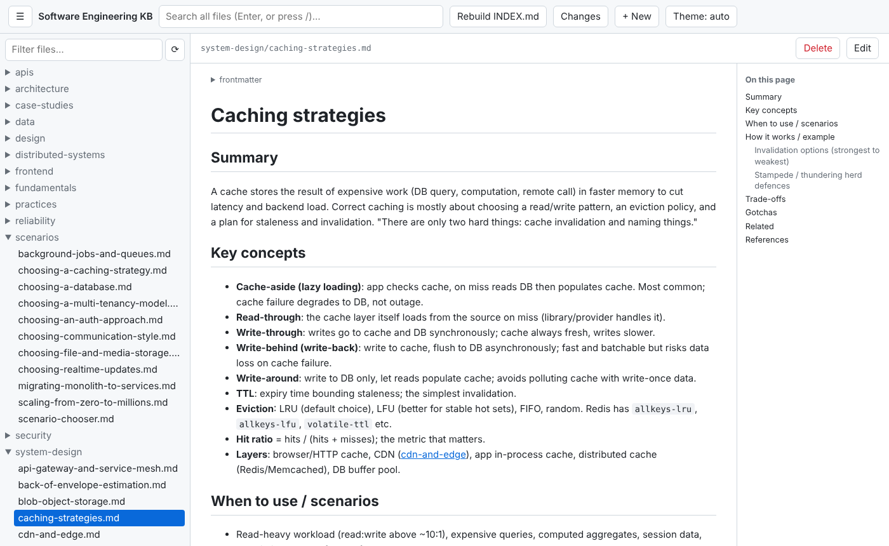

# Software Engineering Knowledge Base

A reference on software engineering and system design, written as plain
Markdown so people and AI coding agents (Claude Code, Codex, Cursor, Copilot)
can look things up before they build.

- **Start here:** [INDEX.md](INDEX.md) lists every topic by category with its tags, use cases and verified date.
- **Terms:** [glossary.md](glossary.md) defines common terms and links each to its topic.
- **For LLM tools:** [llms.txt](llms.txt) is a one-line-per-topic list.
- **By problem:** [scenarios/](scenarios/) maps a requirement to the recommended approach.
- **Design practice:** [case-studies/](case-studies/) holds worked system designs.
- **For agents:** [AGENTS.md](AGENTS.md) explains how to consult and extend the base.
- **Browse and edit locally:** `python3 webapp/server.py --open` ([guide](webapp/README.md)).

## Layout

One topic per file, grouped by category (`fundamentals/`, `design/`,
`architecture/`, `system-design/`, `distributed-systems/`, `data/`, `apis/`,
`reliability/`, `security/`, `testing/`, `frontend/`, `practices/`, `case-studies/`,
`scenarios/`). Each file opens with YAML frontmatter (`tags`, `use_cases`,
`status`, `last_verified`, `sources`) followed by the same sections: Summary,
Key concepts, When to use, How it works, Trade-offs, Gotchas, Related, References.

## Contributing

Copy [_template.md](_template.md) to start a topic, then run
`python build_index.py` to regenerate `INDEX.md` and `llms.txt` and check
`[[links]]`, and `python check_code.py` to compile and run the Python
examples. CI runs both on every push.

## Web app (view and edit)

A local web app to browse, search and edit the base, with a live Markdown preview, an outline, backlinks
and a review page for uncommitted changes:

```bash
python3 webapp/server.py --open     # http://localhost:8775 , stdlib only, no install
```

It listens on 127.0.0.1 only and writes straight to your working copy; commit with git as usual.
The [web app guide](webapp/README.md) shows every feature with a screenshot.



## Related knowledge base

Building an LLM or ML feature? This base covers the system around it
(APIs, queues, caching, observability, security). For the AI side (model
choice, RAG and vector databases, LLM serving, semantic caching, evals,
agents) use the [AI Knowledge Base](https://github.com/faheemkhaskheli9/AI-Knowledge-Base).
Topics that border AI work link to the matching AI KB file from their Related section.

## License

Content is [CC BY 4.0](https://creativecommons.org/licenses/by/4.0/); scripts and code samples are MIT. See [LICENSE](LICENSE).
